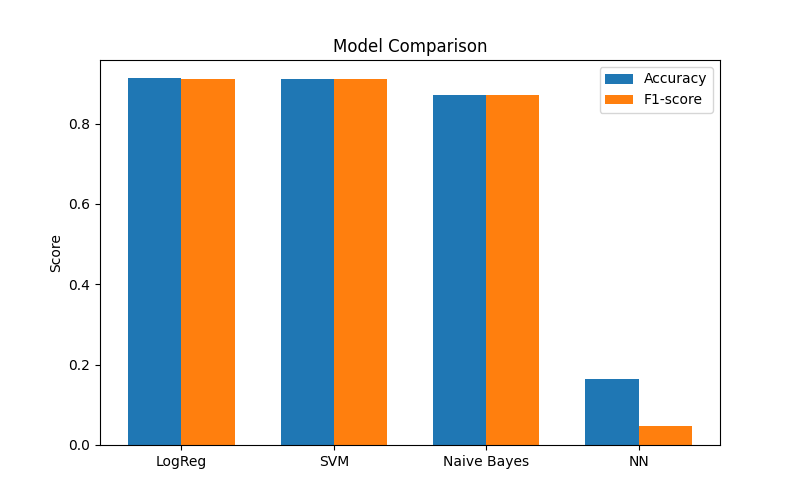
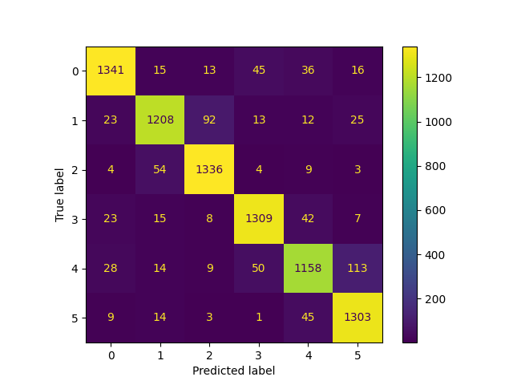

# Emotion Detection from Short Messages

Classifies short English text messages into **six emotions** (sadness, joy, love, anger, fear, surprise) with an NLP + Machine Learning pipeline in Python.

  

## Try it in 30 seconds

The trained models are already in the repository, so you can test them on your own sentences without the dataset:

```bash
pip install scikit-learn joblib
python predict.py "I am terrified of the exam tomorrow"
```

```text
  "I am terrified of the exam tomorrow"
  → fear 😨  (96%)
     joy 😄          1%
     sadness 😢      1%
```

Run `python predict.py` with no arguments for an interactive mode. More examples:

| Message | Prediction |
|---|---|
| I feel so lonely and nobody calls me anymore | sadness (81%) |
| I just got the internship, I am so happy | joy (74%) |
| I can't believe she did that to me, I am furious | anger (96%) |
| I am terrified of the exam tomorrow | fear (96%) |

## Results

All models use the same TF-IDF features (5,000 terms) and an 80/20 train/test split on a balanced subset of **42,000 messages** (7,000 per emotion).

| Model | Accuracy |
|---|---|
| Logistic Regression | **~0.91** |
| Linear SVM (tuned with GridSearchCV, best `C = 0.1`) | **~0.91** |
| Multinomial Naive Bayes | ~0.87 |
| Neural network written from scratch in NumPy | lower (simple 1-hidden-layer network) |

The main comparison metric is the macro **F1-score**; precision, recall and confusion matrices are also reported.

| Model comparison | Confusion matrix (SVM) |
|---|---|
|  |  |

## Pipeline

1. **Balanced subset** – `prepare_subset.py` samples 7,000 messages per emotion.
2. **Cleaning** – `clean.py`: lowercase, remove punctuation and special characters, remove stopwords (NLTK + custom contractions such as *im*, *dont*).
3. **Features** – TF-IDF vectorisation (`max_features = 5000`).
4. **Models** – Logistic Regression, LinearSVC, Multinomial Naive Bayes and a manually implemented neural network (`neural_network.py`: tanh hidden layer + softmax, trained with gradient descent).
5. **Tuning and evaluation** – 5-fold `GridSearchCV` for the SVM; accuracy, precision, recall, F1, confusion matrix and comparison chart.

Trained models are saved in `models/` (`logreg.pkl`, `svm.pkl`, `nb.pkl`, `tfidf.pkl`).

## Run it

```bash
pip install -r requirements.txt
python -c "import nltk; nltk.download('stopwords')"
```

Put the labelled dataset (CSV with `text` and `label` columns) at `data/raw/emotions.csv`, then:

```bash
python prepare_subset.py   # balanced subset  -> data/processed/emotion_subset.csv
python clean.py            # text cleaning    -> data/processed/emotion_clean.csv
python main.py             # train, evaluate, save models and charts
```

Label encoding: `0` sadness · `1` joy · `2` love · `3` anger · `4` fear · `5` surprise.

## Project structure

```text
prepare_subset.py   balanced sampling
clean.py            text preprocessing
main.py             TF-IDF, training, evaluation, charts, GridSearchCV
neural_network.py   NumPy neural network
predict.py          try the saved model on your own text
models/             saved models
images/             result charts
```

## Limitations and next steps

- TF-IDF ignores word order and meaning, so sarcasm and ambiguous messages are hard.
- Next: word embeddings (Word2Vec, GloVe), Transformer models such as BERT, and a small web interface for live predictions.

## Author

**Alexandra Rădulescu** – [GitHub](https://github.com/infinite-alex) · [LinkedIn](https://www.linkedin.com/in/alexandra-r%C4%83dulescu/)
